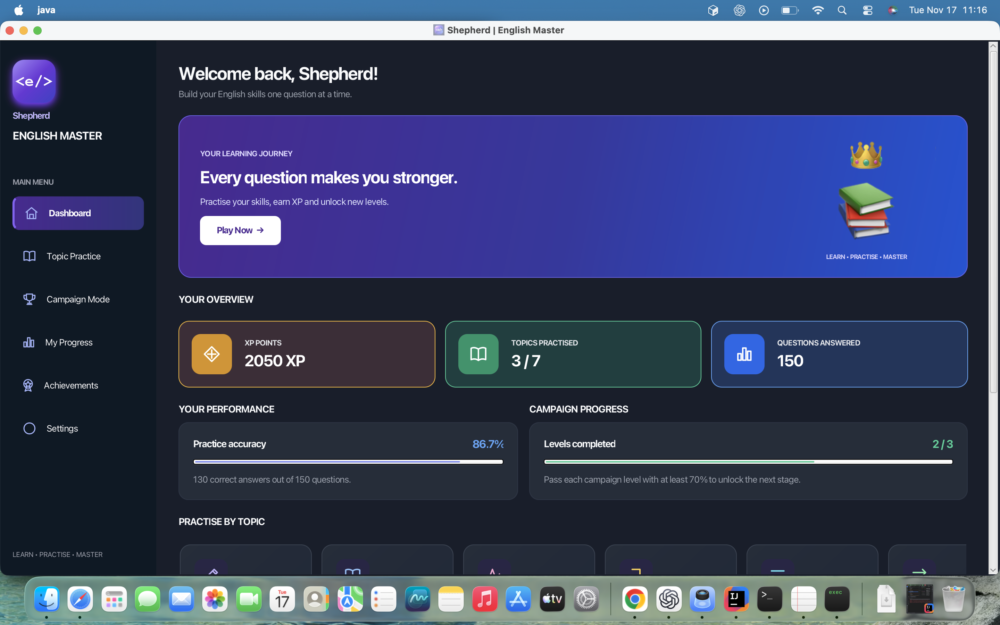
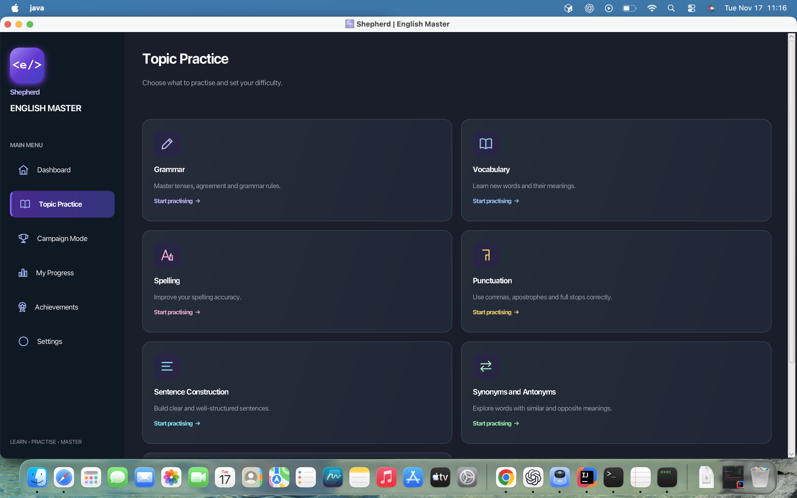
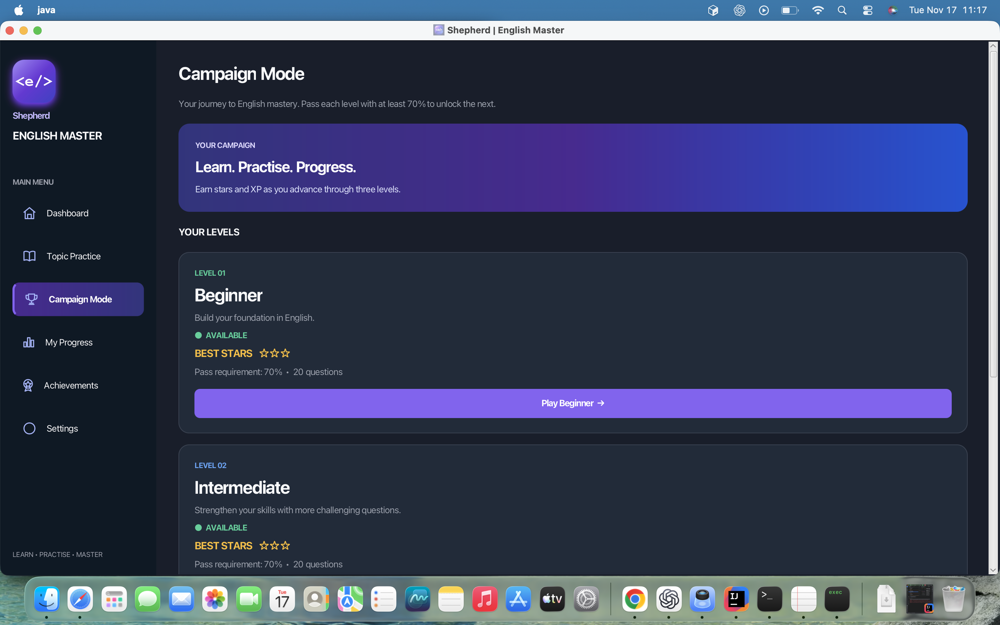
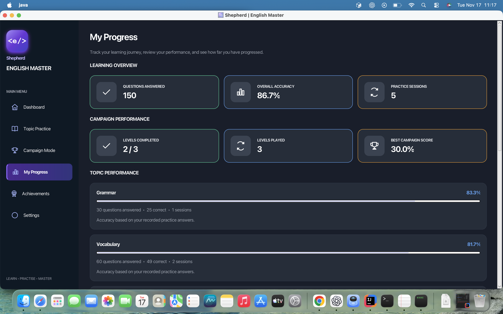

# Shepherd | English Master

<p align="center">
  <strong>Learn. Practise. Master.</strong>
</p>

<p align="center">
  A JavaFX desktop application designed to improve English language proficiency through interactive learning, structured assessments, and performance tracking.
</p>

<p align="center">
  <a href="https://github.com/Iconfresh/EnglishMaster/releases/tag/v1.0.0">Download v1.0.0</a> ·
  <a href="https://github.com/Iconfresh/EnglishMaster/issues">Report an Issue</a>
</p>

---

## Overview

**Shepherd English Master** is an interactive English-learning and computer-based testing (CBT) application built with Java and JavaFX.

The application provides structured English practice across seven learning topics, with three progressive difficulty levels. It combines interactive assessments, campaign challenges, performance analytics, achievements, and audio feedback to create an engaging learning experience.

## Features

- **Topic Practice:** Practise English across seven learning categories.
- **Three Difficulty Levels:** Beginner, Intermediate, and Advanced.
- **Campaign Mode:** Progress through structured assessment levels.
- **Performance Tracking:** Monitor questions answered, accuracy, and learning progress.
- **XP and Stars:** Earn experience points and stars through completed challenges.
- **Achievement System:** Unlock achievements as you improve.
- **Progress Persistence:** Save learning progress between application sessions.
- **Audio Feedback:** Receive sound feedback for correct and incorrect answers.
- **Dashboard:** View learning statistics and campaign progress.
- **Settings:** Manage application preferences.

## Learning Topics

The application currently covers seven English-learning categories:

| No. | Topic                 |
| --- | --------------------- |
| 1   | Grammar               |
| 2   | Vocabulary            |
| 3   | Spelling              |
| 4   | Punctuation           |
| 5   | Sentence Construction |
| 6   | Synonyms and Antonyms |
| 7   | Reading Comprehension |

Each topic supports Beginner, Intermediate, and Advanced practice.

## Campaign Mode

Campaign Mode provides a progressive assessment experience.

- 20 questions per campaign level.
- Minimum passing score of 70%.
- Progressive level unlocking.
- Score tracking and star rewards.
- XP accumulation and achievements.

## Application Screenshots

### Dashboard


### Topic Practice


### Campaign Mode


### My Progress


## Technology Stack

| Technology     | Purpose                                       |
| -------------- | --------------------------------------------- |
| Java 26        | Core application development                  |
| JavaFX 26.0.2  | Desktop graphical user interface              |
| Maven          | Dependency management and build automation    |
| JavaFX Media   | Audio feedback                                |
| Properties API | Local player progress persistence             |
| Git and GitHub | Version control and source hosting            |
| GitHub Actions | Automated builds and cross-platform packaging |
| jlink          | Custom Java runtime generation                |
| jpackage       | Native installer packaging                    |

## Supported Platforms

The v1.0.0 release provides installers for:

- Windows 64-bit
- macOS Intel
- macOS Apple Silicon

## Download and Installation

Visit the [Shepherd English Master v1.0.0 Release](https://github.com/Iconfresh/EnglishMaster/releases/tag/v1.0.0).

Choose the archive corresponding to your operating system:

| Platform            | Release asset                                   |
| ------------------- | ----------------------------------------------- |
| Windows             | Shepherd-English-Master-Windows.zip             |
| macOS Intel         | Shepherd-English-Master-macOS.Intel.1.zip       |
| macOS Apple Silicon | Shepherd-English-Master-macOS.Apple.Silicon.zip |

### Windows

1. Download the Windows ZIP archive.
2. Extract the archive.
3. Run the included `.exe` installer.
4. Follow the installation instructions.

### macOS

1. Download the appropriate macOS ZIP archive.
2. Extract the archive.
3. Open the included `.dmg` installer.
4. Drag Shepherd English Master into Applications.
5. Launch the application from Applications.

## Running from Source

### Prerequisites

- JDK 26
- Apache Maven 3.10.1 or compatible version

### Clone the repository

```bash
git clone https://github.com/Iconfresh/EnglishMaster.git
```

Navigate into the project:

```bash
cd EnglishMaster
```

### Run the application

```bash
mvn javafx:run
```

### Build the application

```bash
mvn clean package
```

The generated JAR file will be available at:

```text
target/english-master-1.0.0.jar
```

## Project Structure

```text
EnglishMaster/
│
├── .github/
│   └── workflows/
│       ├── build.yml
│       └── release.yml
│
├── packaging/
│   └── icons/
│       ├── ShepherdIcon.icns
│       ├── shepherd-icon.ico
│       └── shepherd-icon.png
│
├── src/
│   ├── images/
│   ├── resources/
│   │   ├── sounds/
│   │   └── questions.txt
│   │
│   ├── Main.java
│   ├── Question.java
│   ├── Quiz.java
│   ├── QuizResult.java
│   ├── Level.java
│   ├── PlayerProgress.java
│   ├── QuestionBank.java
│   └── EnglishMasterApp.java
│
├── pom.xml
└── README.md
```

## Automated Build and Packaging

GitHub Actions is used to automate application builds and verification.

The release workflow generates platform-specific installers using:

- Maven for application builds.
- jlink for custom Java runtimes.
- jpackage for native installers.
- GitHub Actions for cross-platform execution.

## Version

**Current Release:** v1.0.0

[View Release History](https://github.com/Iconfresh/EnglishMaster/releases)

## Contributing

Contributions, suggestions, and bug reports are welcome.

To suggest an improvement or report a problem, open an issue in the GitHub repository.

## Author

**Ephraim Yusuf**

GitHub: [@Iconfresh](https://github.com/Iconfresh)

## License

License information has not yet been specified.
